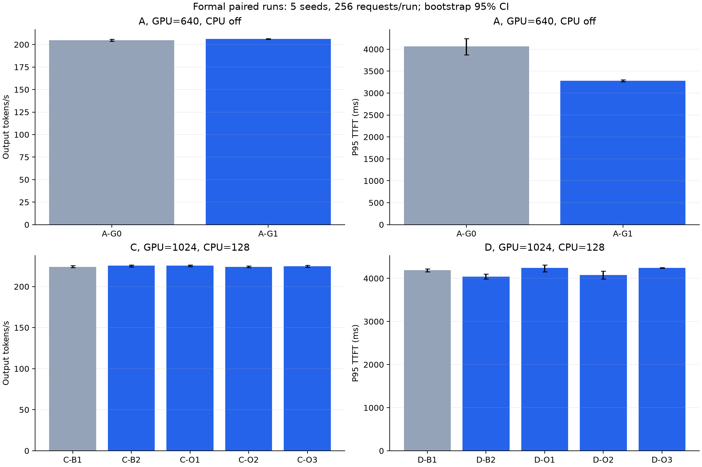
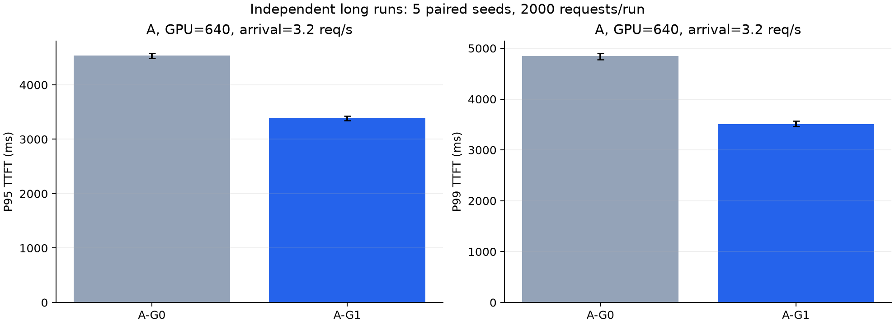
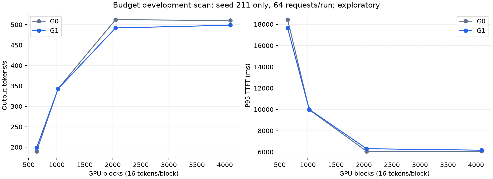
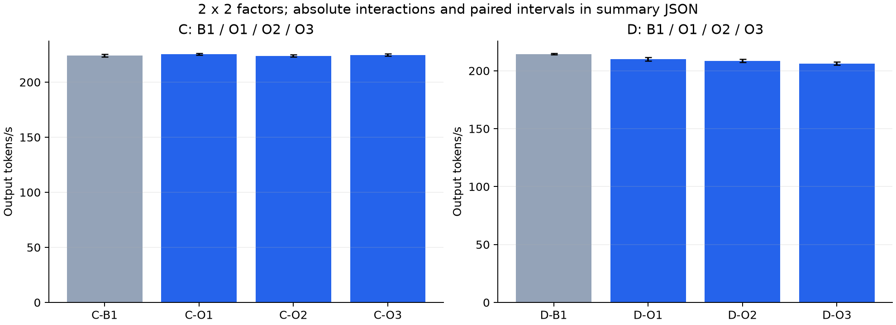
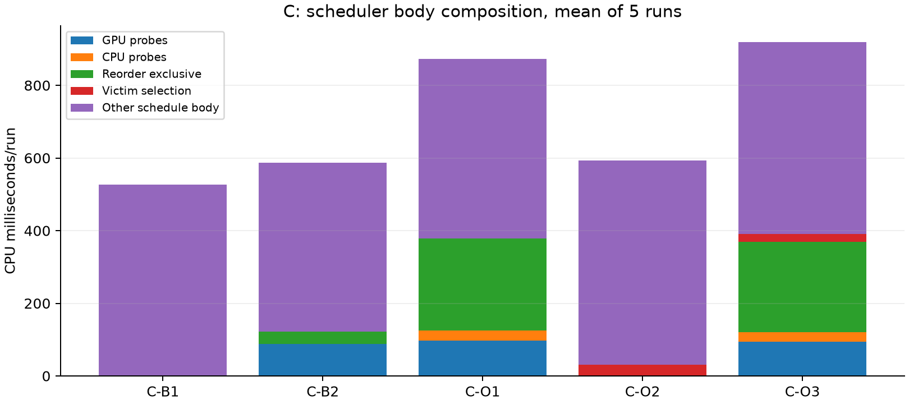
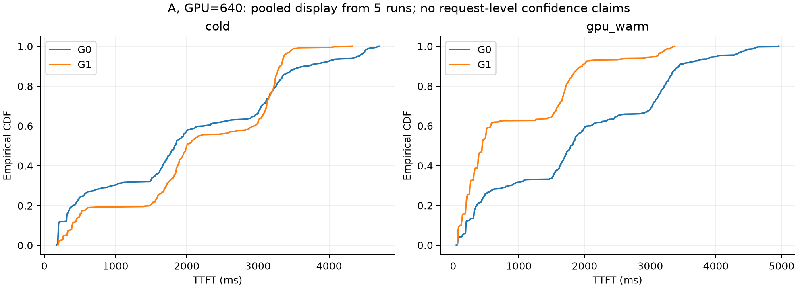
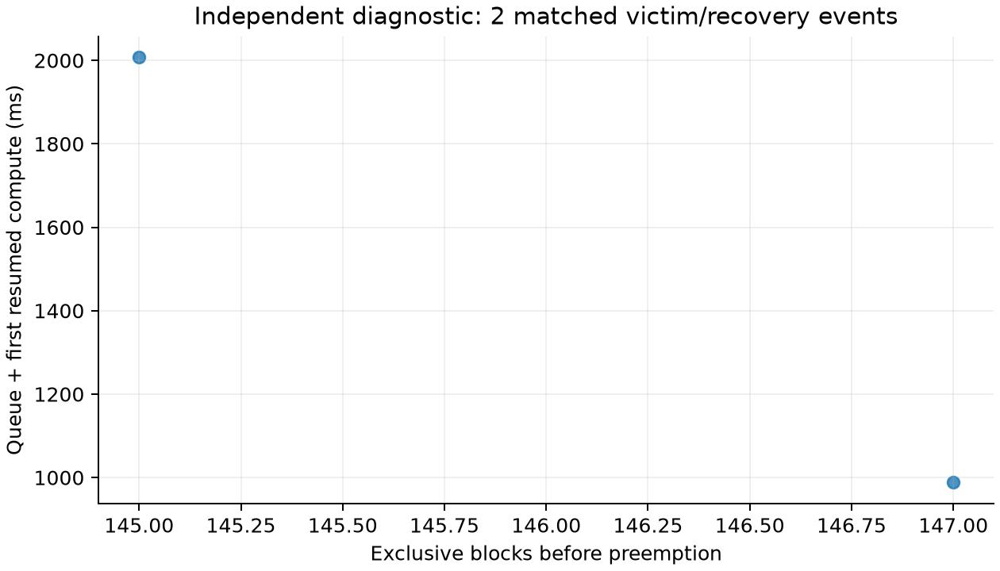
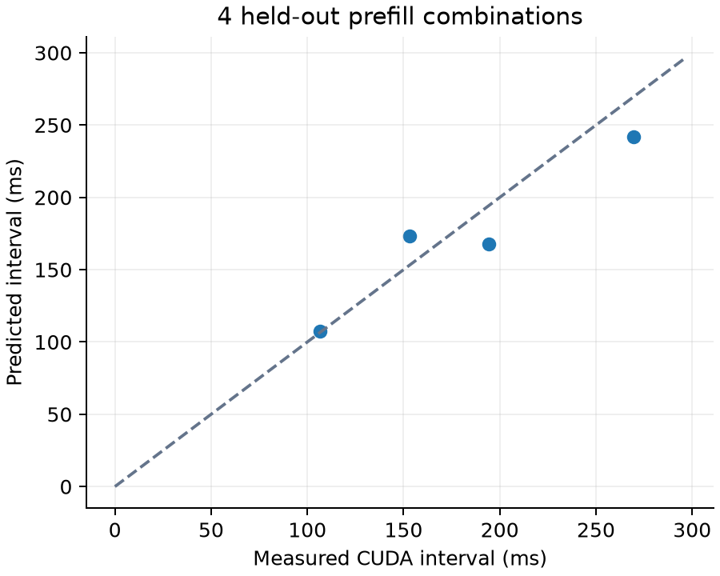

# vLLM KV 分层感知调度：完整实验报告

生成时间：2026-10-19T13:06:27+08:00。固定 RTX 3090 / Qwen3-1.7B FP16 / vLLM 0.11.2。

### 核心实测结果

- 主矩阵共享前缀：吞吐 +0.78% [+0.27, +1.28]；P95 TTFT -19.05% [-22.31, -15.85]。
- 独立 2000 请求长测：吞吐 +0.16% [+0.09, +0.23]；P95 TTFT -25.48% [-26.26, -24.41]。
- CPU 联合 / C：吞吐 +0.32% [-0.80, +1.30]；P95 TTFT -13.28% [-17.16, -9.40]。
- CPU 联合 / D：吞吐 -3.76% [-4.35, -3.08]；P95 TTFT +1.20% [+0.67, +1.94]。
- 重算代价 / B：吞吐 -1.49% [-2.59, -0.48]；P95 TTFT +14.34% [+2.44, +26.24]。

以上均为同种子配对变化及探索性 95% CI；负向结果同样保留。先结合完成率、分类等待与实际执行量，再判断收益边界。

## 1. 完成范围与结论口径

完成 V3 的两个优化模块及同步单卡实验：130 个正式 Run（每 Run 256 请求），167 个开发扫描/消融 Run（每 Run 64 请求），10 个独立长测 Run（每 Run 2000 请求），10 个 HTTP Run（每 Run 128 请求），以及默认行为、自然文本、Teacher-forced 数值和取消压力核验。
GPU/CPU 缓存淘汰仍使用原生 LRU；没有新增搬运 Kernel、主动预取、完整运行请求 Swap 协议、Async 或多卡支持。可选 Mistral 规模验证与 Window=64 扩展未列为必做，本轮未运行。
全部性能结论由以下实际配对结果给出；吞吐正向、延迟/重算负向表示改善。区间跨零时不视为稳定改善。短 Run 的 P99 只作探索；正式 5 次和长测 5 次均为独立 Run，未将单个请求当作独立硬件重复。

## 2. 正式矩阵

同一预算、Trace、种子、缓存准备和公共兼容修复下比较。表中绝对值是 Run 均值，尾延迟是各 Run 分位数的均值。

| GPU / CPU Blocks | 组别 | n | GPU Hit Tokens | CPU Loaded Tokens | 实际重算 | P95 TTFT ms | P99 ITL ms | Output tok/s | Scheduler P95 ms |
| --- | --- | ---: | ---: | ---: | ---: | ---: | ---: | ---: | ---: |
| 640 / 0 | A-G0 | 5 | 233302.400 | 0.000 | 972.200 | 4062.332 | 64.528 | 204.670 | 0.207 |
| 640 / 0 | A-G1 | 5 | 297129.600 | 0.000 | 2284.400 | 3281.000 | 65.114 | 206.252 | 0.501 |
| 640 / 0 | B-G0 | 5 | 248115.200 | 0.000 | 6925.400 | 14382.625 | 66.954 | 158.281 | 0.299 |
| 640 / 0 | B-G2 | 5 | 146832.000 | 0.000 | 144248.600 | 12903.268 | 72.239 | 158.715 | 0.276 |
| 640 / 0 | B-G3 | 5 | 360755.200 | 0.000 | 218248.600 | 19718.942 | 72.410 | 153.249 | 0.367 |
| 640 / 0 | B-G4 | 5 | 299024.000 | 0.000 | 66067.400 | 16441.025 | 68.467 | 155.891 | 0.322 |
| 1024 / 0 | A-G0 | 5 | 310720.000 | 0.000 | 969.200 | 2114.822 | 66.946 | 209.480 | 0.257 |
| 1024 / 0 | A-G1 | 5 | 310374.400 | 0.000 | 2099.600 | 2103.841 | 68.483 | 209.401 | 0.298 |
| 1024 / 0 | B-G0 | 5 | 159779.200 | 0.000 | 6016.000 | 7168.978 | 71.884 | 162.880 | 0.305 |
| 1024 / 0 | B-G2 | 5 | 66739.200 | 0.000 | 88104.600 | 6986.986 | 73.913 | 163.172 | 0.240 |
| 1024 / 0 | B-G3 | 5 | 180211.200 | 0.000 | 127104.800 | 7319.437 | 74.548 | 162.476 | 0.360 |
| 1024 / 0 | B-G4 | 5 | 156198.400 | 0.000 | 44890.000 | 6989.701 | 72.665 | 163.069 | 0.317 |
| 1024 / 128 | C-B1 | 5 | 191129.600 | 161964.800 | 3125.400 | 3809.358 | 82.794 | 224.027 | 0.354 |
| 1024 / 128 | C-B2 | 5 | 226579.200 | 73875.200 | 1964.800 | 3351.211 | 82.577 | 225.356 | 0.497 |
| 1024 / 128 | C-O1 | 5 | 209507.200 | 120038.400 | 2503.800 | 3431.147 | 82.298 | 225.328 | 0.743 |
| 1024 / 128 | C-O2 | 5 | 225132.800 | 170380.800 | 4219.600 | 3742.678 | 85.713 | 223.854 | 0.496 |
| 1024 / 128 | C-O3 | 5 | 241446.400 | 123344.000 | 2885.600 | 3304.508 | 83.873 | 224.728 | 0.749 |
| 1024 / 128 | D-B1 | 5 | 194601.600 | 183347.200 | 2541.400 | 4192.146 | 85.520 | 214.314 | 0.373 |
| 1024 / 128 | D-B2 | 5 | 207321.600 | 175779.200 | 1817.800 | 4036.319 | 84.855 | 212.848 | 0.501 |
| 1024 / 128 | D-O1 | 5 | 203737.600 | 214572.800 | 1630.000 | 4240.921 | 85.475 | 210.165 | 0.787 |
| 1024 / 128 | D-O2 | 5 | 239891.200 | 228217.600 | 2801.200 | 4078.681 | 90.415 | 208.653 | 0.509 |
| 1024 / 128 | D-O3 | 5 | 231900.800 | 254211.200 | 2575.800 | 4242.177 | 91.686 | 206.265 | 0.786 |
| 4096 / 0 | E-G0 | 5 | 0.000 | 0.000 | 0.000 | 2654.723 | 83.484 | 209.154 | 0.235 |
| 4096 / 0 | E-G5 | 5 | 0.000 | 0.000 | 0.000 | 2647.460 | 83.478 | 209.147 | 0.273 |
| 4096 / 0 | F-G0 | 5 | 0.000 | 0.000 | 0.000 | 33.073 | 32.179 | 229.068 | 0.116 |
| 4096 / 0 | F-G5 | 5 | 0.000 | 0.000 | 0.000 | 33.113 | 32.206 | 228.328 | 0.122 |

### 配对变化

| GPU / CPU | 对照 | n | 吞吐变化 [95% CI] | P95 TTFT 变化 [95% CI] | 重算变化 [95% CI] |
| --- | --- | ---: | --- | --- | --- |
| 640 / 0 | A-G1 vs A-G0 | 5 | +0.78% [+0.27, +1.28] | -19.05% [-22.31, -15.85] | +160.66% [+83.93, +239.93] |
| 640 / 0 | B-G2 vs B-G0 | 5 | +0.27% [-0.36, +0.97] | -9.92% [-13.94, -5.91] | +1987.76% [+1835.83, +2203.81] |
| 640 / 0 | B-G3 vs B-G0 | 5 | -3.17% [-4.74, -1.59] | +36.19% [+15.75, +51.54] | +3048.53% [+2947.60, +3149.46] |
| 640 / 0 | B-G4 vs B-G0 | 5 | -1.49% [-2.59, -0.48] | +14.34% [+2.44, +26.24] | +871.47% [+706.23, +1096.33] |
| 1024 / 0 | A-G1 vs A-G0 | 5 | -0.04% [-0.09, +0.01] | -0.49% [-2.04, +1.07] | +242.93% [+47.07, +534.53] |
| 1024 / 0 | B-G2 vs B-G0 | 5 | +0.18% [+0.01, +0.31] | -2.42% [-5.29, +0.25] | +1469.34% [+1115.80, +1966.62] |
| 1024 / 0 | B-G3 vs B-G0 | 5 | -0.25% [-0.42, -0.06] | +1.98% [-0.44, +4.40] | +2124.64% [+1632.98, +2733.63] |
| 1024 / 0 | B-G4 vs B-G0 | 5 | +0.12% [+0.01, +0.22] | -2.26% [-6.01, +1.77] | +649.86% [+577.67, +725.20] |
| 1024 / 128 | C-B2 vs C-B1 | 5 | +0.59% [+0.16, +1.03] | -12.14% [-19.09, -5.20] | -35.03% [-53.89, -16.17] |
| 1024 / 128 | C-O1 vs C-B1 | 5 | +0.58% [+0.06, +1.19] | -9.92% [-15.38, -5.61] | -17.93% [-33.15, +0.02] |
| 1024 / 128 | C-O2 vs C-B1 | 5 | -0.08% [-0.21, +0.06] | -1.73% [-3.40, -0.07] | +35.83% [+20.02, +51.63] |
| 1024 / 128 | C-O3 vs C-B1 | 5 | +0.32% [-0.80, +1.30] | -13.28% [-17.16, -9.40] | -5.36% [-24.66, +11.09] |
| 1024 / 128 | D-B2 vs D-B1 | 5 | -0.69% [-1.41, +0.36] | -3.71% [-5.09, -2.34] | -28.27% [-39.74, -16.79] |
| 1024 / 128 | D-O1 vs D-B1 | 5 | -1.93% [-2.77, -1.15] | +1.18% [-1.51, +3.19] | -35.93% [-42.61, -29.99] |
| 1024 / 128 | D-O2 vs D-B1 | 5 | -2.64% [-3.14, -2.18] | -2.71% [-4.76, -0.96] | +10.35% [-5.04, +26.14] |
| 1024 / 128 | D-O3 vs D-B1 | 5 | -3.76% [-4.35, -3.08] | +1.20% [+0.67, +1.94] | +1.39% [-5.86, +8.64] |
| 4096 / 0 | E-G5 vs E-G0 | 5 | -0.00% [-0.03, +0.03] | -0.30% [-1.29, +0.36] | N/A |
| 4096 / 0 | F-G5 vs F-G0 | 5 | -0.32% [-1.03, +0.15] | +0.12% [-0.16, +0.41] | N/A |

组别：G0=FCFS/Default，G1=GPU Admission，G2=LCF，G3=PR-score，G4=Recompute，G5=GPU Admission+Recompute；B1=CPU Offload+FCFS/Default，B2=GPU Admission，O1=Tier Admission，O2=Restore，O3=Tier+Restore。CPU 组始终保留 Offload。

主矩阵 A/B/C/E 为开放到达的固定突发 Trace；每 16 个请求一组，A/E 为 3.2 req/s、B 为 1.1 req/s、C 为 3.5 req/s。D 为固定 16 条因果请求流、每 4 轮重新开始会话周期，前轮完成后等待 0.1 秒；F 为真正闭环并发 4。低于处理能力时吞吐受提供负载限制，不能把近似相同吞吐解释为最大服务容量相同。

## 3. 独立长测、交互与公平性

长测使用全新种子 307/331/347/367/389；A 的 G0/G1 每 Run 2000 请求、固定 3.2 req/s，GPU 640 Blocks。

| 对照 | 配对数 | 吞吐变化 [95% CI] | P95 TTFT 变化 [95% CI] | P99 TTFT 变化 [95% CI] |
| --- | ---: | --- | --- | --- |
| A-G1 vs A-G0 | 5 | +0.16% [+0.09, +0.23] | -25.48% [-26.26, -24.41] | -27.59% [-28.59, -26.53] |

2×2 交互采用绝对量：O3−O1−O2+B1。不能相加百分比。完整交互区间见 [主汇总 JSON](v3_full_summary.json)，分类等待和调度组成见 [公平性与开销 JSON](v3_fairness_and_overhead.json)。

| GPU / CPU | 策略 | 固定输入类别 | 平均 TTFT ms | 平均 E2E ms |
| --- | --- | --- | ---: | ---: |
| 640 / 0 | A-G0 | cold | 1993.27 | 3236.90 |
| 640 / 0 | A-G0 | gpu_warm | 1904.25 | 3173.71 |
| 640 / 0 | A-G1 | cold | 2153.20 | 3420.44 |
| 640 / 0 | A-G1 | gpu_warm | 918.84 | 2245.44 |
| 1024 / 0 | A-G0 | cold | 1125.92 | 2427.95 |
| 1024 / 0 | A-G0 | gpu_warm | 1035.29 | 2359.62 |
| 1024 / 0 | A-G1 | cold | 1304.96 | 2610.05 |
| 1024 / 0 | A-G1 | gpu_warm | 426.51 | 1916.24 |
| 1024 / 128 | C-B1 | cold | 1805.87 | 3351.63 |
| 1024 / 128 | C-B1 | cpu_warm | 1747.92 | 3305.87 |
| 1024 / 128 | C-B1 | gpu_warm | 1783.51 | 3300.94 |
| 1024 / 128 | C-B2 | cold | 1817.03 | 3337.44 |
| 1024 / 128 | C-B2 | cpu_warm | 1053.94 | 2554.78 |
| 1024 / 128 | C-B2 | gpu_warm | 1268.18 | 2819.96 |
| 1024 / 128 | C-O1 | cold | 2108.27 | 3631.60 |
| 1024 / 128 | C-O1 | cpu_warm | 918.25 | 2384.33 |
| 1024 / 128 | C-O1 | gpu_warm | 1012.14 | 2512.29 |
| 1024 / 128 | C-O2 | cold | 1701.12 | 3229.04 |
| 1024 / 128 | C-O2 | cpu_warm | 1699.71 | 3451.03 |
| 1024 / 128 | C-O2 | gpu_warm | 1760.71 | 3387.20 |
| 1024 / 128 | C-O3 | cold | 1981.34 | 3440.68 |
| 1024 / 128 | C-O3 | cpu_warm | 837.56 | 2506.24 |
| 1024 / 128 | C-O3 | gpu_warm | 947.40 | 2633.07 |
| 1024 / 128 | D-B1 | cold | 2889.37 | 4499.02 |
| 1024 / 128 | D-B1 | cpu_warm | 2883.01 | 4476.15 |
| 1024 / 128 | D-B1 | gpu_warm | 2895.74 | 4495.63 |
| 1024 / 128 | D-O3 | cold | 2988.63 | 4708.43 |
| 1024 / 128 | D-O3 | cpu_warm | 2850.97 | 4646.28 |
| 1024 / 128 | D-O3 | gpu_warm | 2826.72 | 4520.67 |

分类以固定 Trace 的目标类别为主，另保存目标→实际缓存路径映射，避免策略改变类别成员后造成假公平。老化与 2000 ms 阈值约束准入顺序，不能保证 TTFT 小于 2 秒。GPU Hit 含重复准入的复用，不是唯一请求首次命中率。Baseline 不执行优化 Probe，不能把其缺失的 PrefixLoss 当作 0 与优化组比较。原生资源冲突测试已证明 128→96 Tokens 的破坏与 128 Tokens 的保护。

## 4. 扫描、消融与 CPU Offload 因素

完整结果见 [开发扫描与消融](v3_extended_summary.md) / [JSON](v3_extended_summary.json)。覆盖 GPU 640/1024/2048/4096，客户端并发 1/4/8/16/32，Window 0/4/8/16/32，Threshold 0/0.5/0.75/0.9，CPU Blocks 32/64/128/256，公平性开关，CPU Probe 开关，测量成本/线性 Token 成本，资源满足性与进度因子，CPU Block 64/128/256 Tokens（总 CPU Tokens 固定 32768），A 的 1K/2K/4K 前缀与 128/512 后缀，B 的反相关输出预算，D 的 8 条请求流，以及到达速率范围。
关键单因子、CPU 粒度、反相关输出和 Session 对照用 5 个开发种子；范围扫描只用 1 个开发种子，不能据其选出的最好一行宣称稳定收益。Offload On/Off 在相同 GPU 1024、同一 C Trace 下配对，单独保存比较。CPU Probe 关闭时仅禁止优化器读 CPU 元数据，真实 Offload 仍执行。公平性关闭同时关闭 Aging 与超时优先，未将 aging=0 错写成完全关闭公平性。

## 5. 正确性、兼容性与故障核验

测试记录：`56 passed in 7.09s`。
公共兼容修复包括部分 CPU Chunk 映射与抢占 Store Flush 的上游适配，以及本地的生成历史恢复、取消时持有 DMA 源/目标直至完成、双向/重复回调、空闲完成轮询、无 Running 可释放内存时推进已完成加载的持有者。基线与优化共同使用，不把这些修复算作调度收益。失败复现和通过测试均保留；详见 `configs/local_compatibility_fixes.json`。
固定版本取消 API 为 `abort_request([rid])`。本轮初态校验确保请求立即移除且未执行；旧版 quick/formal 的错误参数可能改变缓存初态，旧数据全部排除。所有非队尾预留回滚同时撤销尚未执行的 KV Hash 登记，并恢复 Token Budget 和索引。

| 路径 | 同历史位置数 | Top-1 一致率 | 最大概率差 | 最大 KL | 非近似并列 Top-1 变化 |
| --- | ---: | ---: | ---: | ---: | ---: |
| gpu_pressure | 320 | 100.0000% | 0.00370425 | 0.000103742 | 0 |
| cpu_baseline | 320 | 100.0000% | 0.00528729 | 7.71356e-05 | 0 |
| combined | 320 | 100.0000% | 0.0045604 | 6.68477e-05 | 0 |

上述门槛在本轮运行前固定：最大概率差≤0.01，平均 KL≤1e-4，最大 KL≤1e-3，参考 Margin>0.05 时 Top-1 不变。原始 Logits、RMS 和失败过的旧阈值记录保留，不声称所有原始 Logits 逐位一致。
默认关闭策略与原生 GPU-only 对照的自然输出 38/40 个请求 Token 完全一致；小样本吞吐变化均值 -0.35%。若自然输出有分歧，额外逐 Step 比较相同历史的调度决策和 Logits，不把分歧直接归因于浮点误差。证据见 [默认/自然文本审计](v3_followup_audit.json) 和 `v3_default_numerical_audit.json`。

中文、英文、代码和数学固定集先逐请求验证确定性，再做 CPU/压力混合 Batch。答案原文保留，64 Token 上限会截断部分代码；不当作公共数据集质量分数或语义正确率。

| 自然文本路径 | 单请求完全一致 | Batch 完全一致 | Batch 总数 |
| --- | ---: | ---: | ---: |
| baseline | 12 | 12 | 12 |
| combined | 12 | 12 | 12 |

### 实际生成历史的多轮应用示例

每条路径运行 8 个独立会话、每会话 4 轮。上一轮真实生成的答案写回下一轮上下文，中间插入无关前缀以触发 GPU 淘汰和 CPU 恢复。事实检查只针对本例的项目代号和预算，不是公共质量基准。策略间输入历史可能因答案不同而分歧，因此本例不进入配对性能统计。

| 路径 | 完成请求 | 事实检查通过 / 总数 | CPU Loaded Tokens |
| --- | ---: | ---: | ---: |
| baseline | 32 | 20 / 24 | 67584 |
| combined | 32 | 20 / 24 | 66912 |

取消核验包括 4 Cohorts / 256 请求和 32 Cohorts / 2048 请求；每 Cohort 60 完成、4 在等待/运行/加载/存储状态取消。故障注入只延迟原生完成通知，不改写搬运 Kernel；结束检查 GPU/CPU 引用、Pending Jobs、旧完成集合均归零。该诊断不进入吞吐统计。原生 Worker 不支持故障 DMA 继续运行，非法加载直接报错并拒绝生成性能结果；不能将其写成故障自动恢复。

## 6. HTTP、Profile 与成本模型

HTTP/SSE 使用独立 API Server 与并发异步客户端，B Trace 每 Run 128 请求、5 对种子、1.1 req/s。首个非空内容记 TTFT，SSE 间隔只称 Inter-chunk Latency，不称逐 Token ITL。服务性能与本地同步 Engine 数据分开，客户端发送滞后单独报告。
Nsight Systems 与 cProfile 在独立短 Trace 上采集；范围包含 Seed 与正式诊断，不进入主性能统计。CPU/GPU/搬运数据见 [Nsight CSV 导出](v3_nsys_stats.csv.txt)、数据目录 `profiles/v3_combined.nsys-rep` 与 `profiles/v3_combined_cpu.json`。Scheduler 聚合计时覆盖主主体、排除末尾进度更新；完整函数时间另由 cProfile 保留。Probe 属于 Reorder 子时间，不能重复相加。恢复耗时包含排队至首次恢复计算，不等同于纯 H2D 时间。
Prefill 40 个训练点、4 个留出点，每点 10 次采样；留出误差约 1%～14%。原生多层 H2D 有效斜率约 6.06 GB/s、固定开销约 0.50 ms，连续 Copy 单独记录。成本表不会主动选择理想 min(重算,恢复)，而是估计 Connector 实际会走的路径。
保守 Victim 估计假定 GPU 前缀可能不保留；真实 BlockPool 经常仍能复用。短恢复不在校准网格内，线性外推及多请求竞争也有限制。这些可解释策略收益边界，尚未将修正这些估计的未来工作写成已实现收益。

## 7. 复现、来源与边界

模型 Revision `70d244cc86ccca08cf5af4e1e306ecf908b1ad5e`；vLLM 基础 Commit `275de34170654274616082721348b7edd9741d32`；PyTorch 2.9.0+cu128；FP16、TP=PP=1、Full Attention、同步调度、Eager、max_model_len=8192、GPU Block=16、Batch Tokens=1024、max_num_seqs=16。Window=8、Threshold=0、Aging=0.05、max_wait=2000 ms。固定 8 个可用 CPU Core、OMP=4，不锁 GPU 时钟。
所有模型权重/Tokenizer 文件 SHA256、实际 Overlay 文件、补丁、环境锁、Trace 和逐 Run Manifest 保存在 [复现资料](v3_reproducibility/) 与原始数据目录。方案基于现有二进制做私有源码 Overlay，没有修改原安装。
参考 [Admission #54625](https://github.com/vllm-project/vllm/pull/54625)、[PR-score #56897](https://github.com/vllm-project/vllm/pull/56897)、[LCF #53723](https://github.com/vllm-project/vllm/pull/53723)、[重算观测 #57698](https://github.com/vllm-project/vllm/pull/57698)，固定 Head SHA 见配置。PR-score 的 Token 为 `Request.num_tokens`（Prompt+已生成），进度项不截断；项目 Recompute/Restore 的进度下限为 0.05。均为固定旧版本的参考策略适配，不声称完整 Cherry-pick 复现，也不移用其他硬件 PR 的性能数字。
单命令恢复：在项目目录 `source env.sh` 后执行 `"$KV_EXP_PYTHON" benchmarks/full_pipeline.py`。阶段间校验冻结哈希，已完成项跳过；核心变化必须使用独立发布目录。原始根目录为 `/mnt/ondeviceinfer/experiments/vllm_kv_scheduling`，各阶段见 `pipeline_v3/status.json`。
结果为合成 Token、固定输出预算和单张 3090 上的实验，不能直接外推真实业务、其他模型、公共语义质量、Async 或多卡。主结果、负向结果和单次探索都保留；不以设计目标代替实测。

## 8. HTTP 实测表与导出图

| 策略 | n | Output tok/s | P95 TTFT ms | P95 E2E ms | P99 Inter-chunk ms | P95 发送滞后 ms |
| --- | ---: | ---: | ---: | ---: | ---: | ---: |
| default | 5 | 155.548 | 6612.690 | 9822.061 | 66.011 | 1.812 |
| recompute | 5 | 155.171 | 6572.210 | 9994.326 | 67.233 | 1.784 |
- HTTP output_tok_s 配对变化：-0.23% [-0.57, -0.03]。
- HTTP ttft_p95_ms 配对变化：+2.56% [-4.10, +10.57]。
- HTTP e2e_p95_ms 配对变化：+4.19% [-2.64, +9.12]。

同一端口只绑定本机 127.0.0.1；启用本机开发路由用于预热后重置缓存，配置和每个服务器命令均保留。

### 无复用和低负载对照

开发目标为吞吐均值退化不超过 3%、P95 TTFT 均值增加不超过 3%。该目标单独判断，数据和正确性审计通过不代表性能目标通过；同时保留上文的配对区间。

| 对照 | 吞吐变化 | P95 TTFT 变化 | 3% 开发目标 |
| --- | ---: | ---: | --- |
| E-G5 | -0.00% | -0.30% | 达到 |
| F-G5 | -0.32% | +0.12% | 达到 |

成本模型 4 个留出点的平均相对误差 9.56%、最大相对误差 13.69%；点间耗时排序 5/6 对正确。该排序检查仅针对留出点，不能代表所有 Victim 恢复排序的准确率。

### 机制与公共兼容路径触发量

以下为每 Run 均值。公共 Ready-holder 推进由基线和优化共享，不能归入优化器重排次数。

| GPU / CPU | 组别 | Reorder Calls | Reorder Changes | Non-tail Victims | 预留回滚 | 公共 Ready 推进 | CPU 预测失配 | H2D MiB |
| --- | --- | ---: | ---: | ---: | ---: | ---: | ---: | ---: |
| 640 / 0 | A-G0 | 0.00 | 0.00 | 0.00 | 0.00 | 0.00 | 0.00 | 0.00 |
| 640 / 0 | A-G1 | 1928.80 | 70.60 | 0.00 | 0.00 | 0.00 | 0.00 | 0.00 |
| 640 / 0 | B-G0 | 0.00 | 0.00 | 0.00 | 0.00 | 0.00 | 0.00 | 0.00 |
| 640 / 0 | B-G2 | 0.00 | 0.00 | 248.00 | 236.80 | 0.00 | 0.00 | 0.00 |
| 640 / 0 | B-G3 | 0.00 | 0.00 | 222.00 | 216.40 | 0.00 | 0.00 | 0.00 |
| 640 / 0 | B-G4 | 0.00 | 0.00 | 41.40 | 38.20 | 0.00 | 0.00 | 0.00 |
| 1024 / 0 | A-G0 | 0.00 | 0.00 | 0.00 | 0.00 | 0.00 | 0.00 | 0.00 |
| 1024 / 0 | A-G1 | 986.80 | 64.20 | 0.00 | 0.00 | 0.00 | 0.00 | 0.00 |
| 1024 / 0 | B-G0 | 0.00 | 0.00 | 0.00 | 0.00 | 0.00 | 0.00 | 0.00 |
| 1024 / 0 | B-G2 | 0.00 | 0.00 | 160.40 | 148.80 | 0.00 | 0.00 | 0.00 |
| 1024 / 0 | B-G3 | 0.00 | 0.00 | 129.00 | 124.40 | 0.00 | 0.00 | 0.00 |
| 1024 / 0 | B-G4 | 0.00 | 0.00 | 32.20 | 28.80 | 0.00 | 0.00 | 0.00 |
| 1024 / 128 | C-B1 | 0.00 | 0.00 | 0.00 | 0.00 | 0.00 | 0.00 | 17714.90 |
| 1024 / 128 | C-B2 | 1420.40 | 42.80 | 0.00 | 0.00 | 0.00 | 0.00 | 8080.10 |
| 1024 / 128 | C-O1 | 1517.60 | 55.40 | 0.00 | 0.00 | 0.00 | 2.40 | 13129.20 |
| 1024 / 128 | C-O2 | 0.00 | 0.00 | 49.60 | 36.40 | 0.00 | 0.00 | 18635.40 |
| 1024 / 128 | C-O3 | 1528.20 | 54.80 | 39.40 | 30.00 | 0.00 | 3.60 | 13490.75 |
| 1024 / 128 | D-B1 | 0.00 | 0.00 | 0.00 | 0.00 | 0.00 | 0.00 | 20053.60 |
| 1024 / 128 | D-B2 | 2530.80 | 113.00 | 0.00 | 0.00 | 0.00 | 0.00 | 19225.85 |
| 1024 / 128 | D-O1 | 2647.80 | 181.40 | 0.00 | 0.00 | 0.00 | 7.20 | 23468.90 |
| 1024 / 128 | D-O2 | 0.00 | 0.00 | 58.80 | 51.20 | 0.00 | 0.00 | 24961.30 |
| 1024 / 128 | D-O3 | 2622.00 | 195.00 | 61.60 | 53.80 | 0.00 | 7.00 | 27804.35 |
| 4096 / 0 | E-G0 | 0.00 | 0.00 | 0.00 | 0.00 | 0.00 | 0.00 | 0.00 |
| 4096 / 0 | E-G5 | 188.00 | 0.00 | 0.00 | 0.00 | 0.00 | 0.00 | 0.00 |
| 4096 / 0 | F-G0 | 0.00 | 0.00 | 0.00 | 0.00 | 0.00 | 0.00 | 0.00 |
| 4096 / 0 | F-G5 | 5.00 | 0.00 | 0.00 | 0.00 | 0.00 | 0.00 | 0.00 |

### 正式主结果

### 独立长测

### 开发预算扫描，n=1

### 两模块的 2×2 对照

### Scheduler 主体 CPU 组成

### 固定类别的 TTFT CDF

### 诊断 Victim 释放量与恢复时间

### 成本模型留出点

