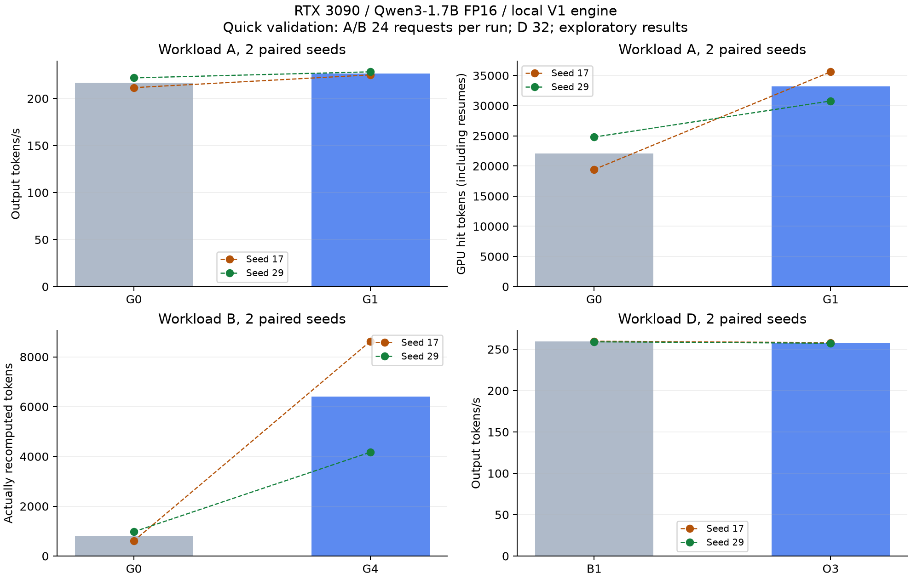

# vLLM KV 分层感知调度：快速实现与效果验证

> 历史探索记录，已被完整实验续跑替代。续跑核查发现初态校验使用了错误的取消 API 参数，校验请求可能实际执行并改变缓存；本文件与原始数据保留，不作为 V3 最终验收依据。最新执行范围见 [PROGRESS](../PROGRESS.md)。

日期：2026-10-19，单卡 RTX 3090。按最新要求停止长矩阵与参数扫描，交付可运行实现、正确性证据和小样本实测；本报告不表示 V3 的完整研究验收已经完成。

## 1. 实测结论

**GPU 前缀感知准入在本轮共享前缀场景中有效：两个种子的吞吐分别提升 6.40% 和 2.89%，配对平均提升 4.65%。代价抢占与 CPU 联合策略尚未证明吞吐收益。**

GPU-aware 同时让冷请求平均 TTFT 从 2743 ms 增至 3323 ms（约 +21.2%），因此有吞吐与请求类别公平性的取舍。当前保留策略开关，默认配置仍为 FCFS / 原生 Victim，不将联合策略作为已验证的通用加速方案。

## 2. 快速对照结果

共 12 个 Run、320 请求：种子 17、29；A/B 每 Run 24 请求，D 每 Run 32 请求。第二个种子反转执行顺序。下表的绝对值是 Run 均值，吞吐变化为同种子配对相对变化的均值。

| 场景 / 策略 | 请求 / Run | Output tok/s | 相对基线吞吐 | P95 TTFT ms | 实际 Prefill Tokens | 实际重算 Tokens | 抢占次数 |
| --- | ---: | ---: | ---: | ---: | ---: | ---: | ---: |
| A / FCFS | 24 | 216.80 | 基线 | 5753.81 | 33696.00 | 120.00 | 1.50 |
| A / GPU-aware | 24 | 226.78 | +4.65% | 5399.96 | 27099.00 | 386.50 | 4.00 |
| B / Default | 24 | 182.75 | 基线 | 16541.05 | 51976.00 | 793.50 | 9.50 |
| B / Recompute | 24 | 183.66 | +0.70% | 15902.34 | 57522.00 | 6399.50 | 13.50 |
| D / CPU Baseline | 32 | 259.40 | 基线 | 3223.63 | 24944.00 | 317.00 | 3.00 |
| D / Tier + Restore | 32 | 257.69 | -0.66% | 3278.22 | 21776.00 | 64.00 | 2.00 |

- **A，共享前缀 + 冷请求混合，GPU 640 Blocks、无 CPU Offload。** GPU 命中均值从 22,112 增至 33,200 Tokens，实际 Prefill 从 33,696 降至 27,099 Tokens（-19.58%）。Warm 请求平均 TTFT 从 2883 降至 1576 ms；冷请求变慢。抢占从 1.5 增至 4 次，重算从 120 增至 386.5 Tokens，说明收益来自减少前缀重新 Prefill，而非减少抢占。GPU 命中统计包含抢占后再准入的复用，不能当作唯一请求首次命中率。
- **B，混合长度冷请求，GPU 640 Blocks、无 CPU Offload。** Recompute 吞吐分别变化 -1.60%、+3.00%，平均 +0.70%；实际重算从 793.5 增至 6399.5 Tokens，约为基线 8.06 倍，尚未实现预期目标。不能把近零平均吞吐变化写成稳定优化。
- **D，16 个 Session、每个 2 轮，GPU 1024 / CPU 128 Blocks。** 联合策略重算从 317 降至 64 Tokens（-79.81%），但吞吐下降 0.66%。CPU 实际加载从 38,912 降至 36,032 Tokens。冷请求平均 TTFT 从 1925 增至 2460 ms，不能只依据重算减少宣布性能改善。



图中点为两个独立种子，柱为 Run 均值。仅两次重复，不对稳定收益、显著性或服务 P99 作结论。完整数值见 [quick_summary.md](quick_summary.md) / [JSON](quick_summary.json)。

## 3. 已有 CPU 分层数据

停止长测前已完成 22 个 W-C Run，每 Run 256 请求，共 5632 请求；这些数据继续保留，未重新运行。W-C 混合 GPU Warm、CPU Warm、Cold 三类请求，GPU 1024 / CPU 128 Blocks。不同策略完成的种子数不同，以下只使用与基线匹配的种子：

| 策略 | 配对数 | 吞吐变化 | P95 TTFT 变化 | 重算量变化 |
| --- | ---: | ---: | ---: | ---: |
| C-B2 | 4 | +0.39% | -0.43% | -0.36% |
| C-O1 | 4 | -0.99% | +1.20% | -6.16% |
| C-O2 | 4 | +0.59% | -0.71% | -0.11% |
| C-O3 | 5 | -1.64% | +1.87% | +13.81% |

B2=GPU Admission；O1=Tier Admission；O2=Restore Victim；O3=Tier + Restore。均相对 B1=FCFS + Default。联合策略在 5 个配对种子中吞吐均下降，配对均值 -1.64%；本轮 CPU 分层假设未获得支持。O2 的约 +0.59% 吞吐变化很小，尚不能称为稳定收益。

可能原因：当前恢复估计保守地将 Victim 的 GPU 保留量设为 0，而原生 BlockPool 在抢占后经常仍能复用大量前缀；此外，1～16 Token 的短恢复不在校准网格内，线性外推会低估固定开销。这些是与实现和计数相符的解释，尚未通过新的消融验证。本轮按快速要求不继续调参。

完整数据见 [formal_summary.md](formal_summary.md)。原设计为 130 Run，本轮仅完成 22，不能把该目录名 formal 理解为完整验收。中断 Run 没有 metrics.json，不进入汇总；旧修复版本的 formal_pre_* 和早期 Pilot 全部排除。

## 4. 实现与正确性

实现位于 `kv_sched/policy.py`、`kv_sched/runtime.py` 与 `patches/`：有限窗口稳定准入排序、状态屏障和老化；GPU / CPU Ready 只读探针；真实可释放 Block 计数；LCF、PR-score、Recompute、Restore Victim；成功执行区间重算账本；GPU/CPU 命中、实际搬运、调度时间、恢复时间和请求分类观测。

使用现有 vLLM 二进制配合私有源码 Overlay，没有修改原有安装或复制模型。Stock 与 Optimized 都应用相同 CPU 兼容修复，避免将兼容性修复算作调度收益。额外处理了部分 CPU Chunk 映射、抢占 Store Flush、CPU 恢复生成历史，以及本轮预留但未执行的 KV Hash 回滚。

- **34 项测试通过**，含真实 vLLM Manager、Scheduler、GPU 搬运和恢复历史回归。原生资源冲突测试中，Cold 先准入将 Warm 可复用前缀由 128 降至 96 Tokens；GPU-aware 先准入则保持 128，验证了机制。
- **相同历史数值核验**：GPU 压力对照、CPU 基线、联合策略各检查 5 个请求 × 64 位置。联合策略 Top-1 一致率 99.6875%，最大概率差 0.004389，最大 KL 6.61e-5；参考 Margin>0.05 的位置无 Top-1 变化。
- 最初原始 Logits 绝对差阈值连 GPU-only 压力对照也未通过；保留失败记录，随后增加概率 / KL / Margin 与 GPU 对照核验。这不代表通过了原始阈值，或证明所有输入都数值等价。详见 [正确性与兼容修复报告](正确性与兼容修复报告.md)。
- 快速对照的自然贪心输出逐请求一致数为：A 47/48、B 47/48、D 64/64。少量生成分歧保留在请求数据中；上述相同历史核验使用 W-C，不能据此证明 A/B 的全部分歧原因或宣称文本完全一致。尚未运行公共数据集或自然文本质量评测。
- **快速数据审计通过：12/12 Run，320/320 请求完成，0 项错误。** 核对请求 ID、输出长度、配对 Trace Hash、H2D 提交与完成字节、成本回退和未确认执行计数。已有 22 Run 同样没有数据检查错误，但完整 130 Run 的完成门槛未满足。

审计证据：[快速审计](quick_completeness_audit.json)、[原矩阵部分审计](formal_completeness_audit.json)、[数值核验](teacher_forced_quality.json)、[核心源码一致性](reproducibility/source_consistency.json)。

## 5. 环境与代价校准

RTX 3090 24 GiB；Xeon Gold 6152；Qwen3-1.7B FP16，Revision `70d244cc86ccca08cf5af4e1e306ecf908b1ad5e`；vLLM 0.11.2，基础 Commit `275de34170654274616082721348b7edd9741d32`；Torch 2.9.0+cu128。仅单卡、TP=PP=1、Full Attention、同步调度，关闭 Speculative / LoRA。

GPU Block=16 Tokens；CPU Block=256 Tokens，128 Blocks 为约 3.5 GiB KV Payload。GPU 640 / 1024 Blocks 的理论 KV Payload 约 1.09 / 1.75 GiB，用人为缩小的 KV 预算制造压力；这不是 3090 的物理显存上限。最大 Batch Tokens=1024，最大并行请求=16，Chunked Prefill 与 Prefix Cache 开启，Eager 模式。准入窗口 8、阈值 0、老化系数 0.05、最大准入等待阈值 2000 ms；该阈值不保证 TTFT 小于 2 秒。OMP_NUM_THREADS=4，记录进程实际允许的 CPU 亲和性，未单独绑核或锁定 GPU 时钟。

本机已校准 40 个 Prefill 网格点与 4 个留出点，每点 10 次正式采样 + 2 次预热；留出相对误差约 1%～14%。原生多层 CPU→GPU Handler 的有效带宽斜率约 6.06 GB/s、固定开销约 0.50 ms，与理想连续 Copy 分开记录。结果：[成本表](reproducibility/qwen3-1.7b-3090.json)、[留出验证](reproducibility/validation.json)、[校准图](figures/cost_calibration.png)。

所有性能数据来自本地同步 V1 Engine，计时排除模型加载、Shape Warmup 与 Seed；A/B/C 是固定到达 Trace，D 是固定 Token 历史与前轮完成依赖。输入为合成 Token，输出长度固定；不能直接外推真实业务。请求提交延迟单独保存，TTFT 按实际提交时刻计算，不含此前的提交滞后。Scheduler 计时覆盖主调度主体，未包含末尾进度更新的少量时间。

本轮未运行完整 130 Run、HTTP/SSE、Nsight、默认补丁开关开销对照、自然文本质量、长测与参数消融，亦未验证 Async / 多卡 / 其他模型。小样本 P95/P99 和 Bootstrap 区间只供探索，不能替代生产 SLO 验收。

## 6. 复现与交付路径

项目目录：`/home/sdn/wjh/Ondeviceinfer/source/vllm_kv_scheduling`；环境、模型链接、Overlay 和原始数据：`/mnt/ondeviceinfer/experiments/vllm_kv_scheduling`。初始化与完整说明见 [README](../README.md)。

```bash
cd /home/sdn/wjh/Ondeviceinfer/source/vllm_kv_scheduling
source env.sh
"$KV_EXP_PYTHON" benchmarks/run_quick.py
"$KV_EXP_PYTHON" benchmarks/summarize.py --label quick
"$KV_EXP_PYTHON" benchmarks/audit_results.py --label quick --expected-runs 12
python benchmarks/plot_quick.py  # 使用本机有 matplotlib 的 Python
```

快速脚本跳过已有完成 Run；如需重新测量，先保留并移走 `raw/quick`，避免覆盖证据。直接启用 GPU-aware 的最小示例：

```bash
"$KV_EXP_PYTHON" benchmarks/run_trace.py \
  --workload A --requests 24 --blocks 640 --admission gpu \
  --cost-model "$KV_EXP_DATA/cost_models/qwen3-1.7b-3090.json" \
  --output "$KV_EXP_DATA/raw/example-gpu-admission"
```

当前可复现的正向结果是共享 GPU 前缀场景的吞吐 / Prefill 改善，同时存在冷请求 TTFT 代价。恢复代价策略仍需改善估计与候选选择后再验证；本轮不继续扩大实验。
